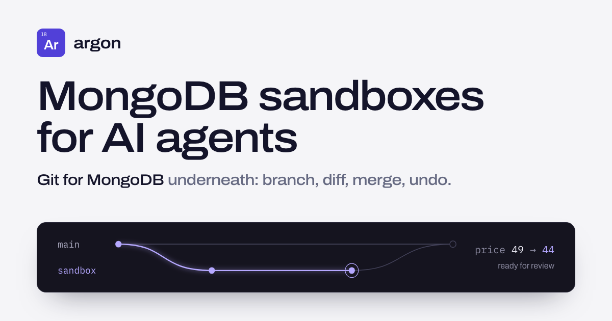

# Argon — MongoDB sandboxes for AI agents

<p align="center">
  <a href="https://argonlabs.tech">
    
  </a>
</p>

[](https://github.com/argon-lab/argon/actions/workflows/ci.yml)
[](https://goreportcard.com/report/github.com/argon-lab/argon)
[](https://opensource.org/licenses/MIT)
[](https://github.com/argon-lab/homebrew-tap)
[](https://www.npmjs.com/package/argonctl)
[](https://pypi.org/project/argon-agents/)
[](https://mcp.market/server/argon-lab-argon)

**Give every agent run its own real MongoDB database, forked from your data.
Review what it changed, merge what you want, discard the rest. Git for MongoDB
underneath: branch, diff, merge, time travel and undo. Any driver, real mongod.**

**Your data can live on MongoDB Atlas.** From 2.12.0 Argon imports and follows
an Atlas database, on the free M0 tier or a dedicated replica-set cluster such
as M10, gives agents sandboxes of it, and writes reviewed changes back to
Atlas. The engine and the sandboxes run on a MongoDB replica set you run;
sharded clusters are not supported. See
[MongoDB Atlas as a source](docs/OPERATIONS.md#mongodb-atlas-as-a-source).

Three ideas, thirty seconds:

1. **A sandbox is a real MongoDB database** — forked from a branch or a pinned
   dataset, checked out and given a TTL in one command. pymongo, mongoose,
   mongosh, indexes, aggregation, transactions: all real.
2. **What the agent wrote is a diff** — supported document writes become
   history while capture is healthy, so a run can be reviewed, merged as a data
   pull request, undone or thrown away. Your source data is untouched until you
   merge.
3. **Underneath, it is Git for MongoDB** — a branch is a pointer created with a
   metadata write; checkout separately materializes the data. Diff, merge, undo
   and pins work within the configured retention and capture guarantees. The
   commands are [side by side with Git](#git-for-mongodb) below.

## Install

For npm, use Node.js 24 LTS with npm 11.16 or newer. The package-scoped
approval allows the installer to download Argon's binary on npm 12.

```bash
brew install argon-lab/tap/argonctl      # macOS or Linux, builds from source
npm install -g argonctl --allow-scripts=argonctl # cross-platform

# MongoDB must run as a replica set (one-node is fine):
docker run -d --name argon-mongo -p 127.0.0.1:27017:27017 mongo:7 --replSet rs0
docker exec argon-mongo mongosh --quiet --eval 'rs.initiate({_id:"rs0",members:[{_id:0,host:"localhost:27017"}]})'
argon doctor
```

Use a current supported MongoDB patch release in production. Source builds use
Go 1.26.11 or newer, as declared in `go.mod`. Use a patched toolchain: on the
Go 1.27 line that means 1.27.4 or newer, which carry the same standard-library fixes.

## The flow

```
your data ──sandbox──▶ mongodb://…  ← the agent, any driver
                           │
          argon diff ──────┤  what the run changed
              ▼            ▼
   merge (a data PR)   or  discard / undo
```

```bash
# 0 · Bring your data in once, from a database nobody is writing to — or: argon projects create myapp
#     (a database that is in use: see "A database that is in use" below)
argon import database --uri mongodb://localhost:27017 --database myapp --project myapp --source-quiesced

# 1 · In terminal A, a sandbox: fork + checkout + TTL + capture in one command.
#     Prints its name and a connection string, then keeps capturing until Ctrl-C
argon sandbox create -p myapp --ttl 1h --watch --actor agent:run-1

# In terminal B, point the agent at the printed URI. Then:

# 2 · Review, then adopt the run — a data pull request
argon diff          -p myapp -b <sandbox>
argon merge preview -p myapp -b <sandbox>
argon merge apply <plan-id>

# …or throw the run away
argon sandbox discard -p myapp -b <sandbox>
```

On a MongoDB deployment with access control, add `--credential` to
`argon sandbox create` to get a URI that can read and write only that
sandbox. Save the URI when the command prints it. The credential stays valid
until you discard the sandbox or a sweep reaps it after expiry.
See [Exposure and credentials](docs/OPERATIONS.md#exposure-and-credentials).

Through the MCP server or `argon console`, capture and expiry are managed for
you: nothing stays in the foreground, and expired sandboxes are swept every
minute. `--watch` needs 2.3.0 or newer; on older versions run
`argon watch -p myapp -b <sandbox> --actor agent:run-1` after creating the sandbox.
Long-lived branches work the same way with `argon branches create` and
`argon checkout`, and `argon restore reset` rewinds a branch to an earlier time.

### A database that is in use

Online import and the `argon source` commands, introduced in 2.6.0, are now
available by default. You can import a replica-set database while writers
keep running, then follow its changes on the project's `main`. Write-back is
also available by default. Review the plan in CLI JSON and pass its digest
when applying it to the source. The experimental options `--auto-resync`
and `--enable-source-images` are off by default and each requires
`ARGON_EXPERIMENTAL_SOURCE=1`. The deployment tests exercise authenticated
TLS connections, primary elections on a three-member source, MongoDB 6.0
and 8.0 sources with a 7.0 engine, and an 8.0 engine with a 7.0 source.
MongoDB Atlas is tested as a source on a free M0 cluster and a dedicated M10,
with least-privilege custom roles; see [MongoDB Atlas as a source](docs/OPERATIONS.md#mongodb-atlas-as-a-source).
Sharded sources remain untested. For source roles and deployment limits, see
[the operations guide](docs/OPERATIONS.md#following-a-source-database).

```bash
export ARGON_SOURCE_URI="mongodb://…"     # read per command, never stored
argon import preview --database myapp --online
argon import database --database myapp --project myapp --online
argon source follow -p myapp              # main tracks the source; leave it running

argon sandbox create -p myapp --ttl 1h --watch --actor agent:run-1
argon merge preview -p myapp -b <sandbox> --output json
argon merge apply <plan-id> --write-back --approve <approval_digest>
```

The import copies ordinary collections at one cluster time, which it prints.
Add `--dry-run` to the import command to check the source and its change stream
and see the estimated copy without writing anything.
Following ignores changes to views. New merge plans save ordered BSON. CLI
JSON preview and list show the order apply writes, preserve BSON types with
canonical Extended JSON, identify literal documents with dollar-prefixed
fields and show exact bytes wherever JSON loses a BSON distinction. For a
pending plan targeting a followed database, inspect this output and pass its
`approval_digest` to `--approve`. To inspect a saved plan, run
`argon merge list -p myapp --output json`. Before approving, run
`argon merge check <plan-id>` to report unique-index collisions against the
source and within the plan. Plans saved by older versions
require a fresh preview. Write-back
requires a verified, saved before-image for every replacement or delete and
a verified after-image for every insert or replacement. An empty plan
completes in metadata. For a nonempty plan, Argon checks capture health and
claims the plan with majority acknowledgment, then checks existing documents
byte for byte and insert keys for absence in one source transaction. Before
commit, it reads each affected key again to verify the exact stored BSON or
confirm deletion. A mismatch rolls back the batch and returns the plan to
pending. A top-level zero BSON timestamp outside `_id` must be changed on the
editable branch before write-back. Detach refuses while a recent claim is
unsettled and reports older unsettled plans for inspection.
Write-back and `--enable-source-images`
require importing with a user allowed to run `replSetGetConfig`, such as one
with the `clusterMonitor` role. On Atlas M0 and Flex, which refuse it, a
TLS-verified `mongodb.net` connection identifies the source instead. Use
`argon source status` to see which identity check applies. The MCP server and REST API do not offer write-back. Argon
never drops, renames or rewrites a source database. See
[the operations guide](docs/OPERATIONS.md#following-a-source-database).

Write-back refuses capped collections and byte-identical replacements
before claiming a plan. Ordinary merge also checks the
inner length of deprecated BSON binary subtype 2 when decoding stored images.

An older delete can refer to either an empty subtype-2 `_id` or four zero
bytes. Reads that depend on it report the key. If GC removed the relevant
WAL and subtype-2 ID evidence survives, reads that need the old snapshot
report the unknown LSN range. For a followed branch, stop the follower and
run `argon source resync -p myapp --force`. On an ordinary branch, fork
from an earlier readable LSN with `argon restore branch` or rewind its
head with `argon restore reset`. With `argon import database`, the copy
goes into a new project and the existing branch keeps its history. See
[upgrade and recovery details](docs/OPERATIONS.md#upgrading-older-snapshots).

If a plan stays `writing_back`, check the affected documents on the source,
let following catch up, and run `argon merge preview` again for the sandbox.

Run `argon source status -p myapp` to see whether `main` is verified at its
saved source cluster time. A clean stop at an exact checkpoint exits zero,
as does `restarting` while a live follower reopens its stream from that checkpoint.
An open catch-up range, a stored capture error or an expired owner exits
nonzero even when the state says `stopped`. Table and JSON output give the
reason and next action. `argon status` and `argon doctor` report the same
health. Write-back preflight requires `exact`. See the
[source status table](docs/OPERATIONS.md#what-argon-source-status-reports-and-what-to-do).

Each project can run one follower or resync at a time. Restart following
after lease loss and let the replacement verify its checkpoint.
`argon source follow --auto-resync` completes an unfinished resync or repairs
a source stream gap. The option checks `ARGON_EXPERIMENTAL_SOURCE=1` at startup.

Operators can enable `changeStreamPreAndPostImages` directly on MongoDB
or use `--enable-source-images` on online import or follow. When requested,
`source follow --enable-source-images` checks the lease before altering each
collection. An error after a change lists the affected collections.

Prefer clicking? `argon console` serves a local web console (UI + REST API),
supervises capture, reaps expired sandboxes every minute, and opens your browser.
The console's MIT-licensed source is in [web/](web/README.md); see the
[rebuild instructions](CONTRIBUTING.md#console-source-and-reproducible-assets).
For a complete managed workflow, run [the two-agent pinned dataset example](examples/pinned_agents.py),
or [an OpenAI Agents SDK agent in a sandbox](examples/openai_agents_sandbox.py).

## For AI agents

```bash
claude mcp add argon -- argon mcp        # 14 tools: sandbox, diff, merge, undo, pins
# Install the published Python SDK and LangGraph adapter.
python3 -m pip install 'argon-agents[langgraph]==0.3.0'
```

Start `argon console --no-browser` in another terminal, then:

```python
from argon_agents import ArgonClient, ArgonCheckpointSaver

argon = ArgonClient("http://127.0.0.1:1818")
argon.get_or_create_project("myapp")
saver = ArgonCheckpointSaver.from_sandbox(argon, "myapp")
# Compile and run your LangGraph graph with checkpointer=saver, then review:
plan = argon.merge_preview("myapp", saver.sandbox.branch)
print(plan)
# After reviewing this exact plan, apply it explicitly:
# argon.merge_apply(plan["id"])
# Or reject the run: saver.discard()

argon.create_pin("myapp", "eval-v1")                        # pin the dataset once
run = argon.sandbox_from_pin("myapp", "eval-v1")            # identical state, every eval run
```

`saver.merge()` is a convenience call that previews and applies immediately;
use the separate calls above when approval is required. Pins protect captured
document state while they exist; keep independent backups.

To keep a person in the loop, withhold tools from the MCP server:
`argon mcp --disable-tools argon_merge_apply` leaves applying a merge plan to
`argon merge apply <plan-id>`, and `argon mcp --read-only` offers only the
tools that inspect state.

Agent-written code that runs in a code sandbox can write to an Argon sandbox
through a MongoDB user made for one run:
[examples/boxd-sandbox](examples/boxd-sandbox/) does that with an isolated
[boxd](https://boxd.sh/) machine, and boxd's documentation has
[a page for the integration](https://docs.boxd.sh/use-cases/oss-integrations/argon).

The full agent workflow: [docs/AGENTS.md](docs/AGENTS.md).

## Git for MongoDB

Underneath the sandbox, Argon does for MongoDB documents what Git does for
files. Side by side:

| In Git | In Argon | What it does to your data |
|---|---|---|
| `git branch` | `argon branches create` | adds a pointer into shared history; no documents are copied |
| `git worktree add` | `argon sandbox create` | gives a new branch its own working copy: a real MongoDB database, with a TTL |
| `git diff` | `argon diff` | lists the documents a branch would add, change or remove |
| `git merge` | `argon merge preview`, then `argon merge apply` | saves the change as a plan to review, then applies exactly that plan |
| `git checkout <commit>` | `argon time-travel query` | reads the data as it was at an earlier position in retained history |
| `git revert` | `argon undo` | reverses earlier writes with a new change; history is not rewritten |
| `git tag` | `argon pin create` | names one fixed state and protects its history while the pin exists |

Where it differs from Git: there is no commit step, because a running capture
process records each document change. A merge goes from a branch into its
parent and compares whole documents. Checking out a branch copies its data, so
it takes time and storage that depend on the dataset. Documents are versioned.
Secondary indexes are not, but a checkout builds the latest definitions
recorded for its branch; collection options are not copied. History older than the retention
window can be reclaimed unless a pin protects it.

## What you get

| | Command | In one line |
|---|---|---|
| **Sandboxes** | `argon sandbox create --ttl 1h [--credential]` | fork with a TTL and an optional MongoDB user scoped to the sandbox |
| **Dataset pins** | `argon pin create` / `pin sandbox` | named captured states protected from GC and resets while the pin exists |
| **Data PRs** | `argon merge preview/check/apply` | three-way merges as reviewable plans; conflicts never silent |
| **Source following** | `argon import database --online` / `argon source follow` | import, follow and write back a live replica set or MongoDB Atlas cluster (M0 included) |
| **Undo** | `argon undo --actor <a>` | revert a range or actor label; append-only, conflict-aware |
| **Real databases** | `argon checkout` / `argon proxy` | any driver, real mongod; proxy serves stable `mongodb://host/<project>~<branch>` URIs |
| **Write capture** | `argon watch` | exact change-stream images → history, one actor label per branch |
| **Branching** | `argon branches create` | a metadata write; copies no documents |
| **Time travel** | `argon time-travel query` | query captured document states at retained LSNs; restore/pin also accept timestamps |
| **Restore** | `argon restore preview/reset/branch` | rewind a released branch or fork retained history |
| **Web console** | `argon console` | local UI + REST API in one command |

Data history covers document inserts, updates, replacements and deletes. Collection
drop/rename produces degraded capture. Index definitions are recorded from
the source and from captured index builds, and a checkout builds them; they
are not versioned, and collection options are not copied. Native writes are asynchronous; control operations drain capture.
Stop writers before release. Existing pins protect their referenced states, while GC can expire audit
and undo history. See [operations](docs/OPERATIONS.md) for recovery and credentials.

Two things to know before handing a sandbox to an agent. A collection the agent
creates is captured exactly while capture is running, or when it is next
synchronized within MongoDB's snapshot history (five minutes by default); the
one exception is a document that is updated and then changed again inside one
transaction on a collection created moments earlier. Before 2.3.1 such a collection needed
`argon collections prepare` first. And a sandbox is a full physical copy with
capture ready, so creating one takes longer as the data grows: the
[benchmarks](https://github.com/argon-lab/benchmarks) measure it as
`sandbox_capture_ready_ms`.

Storage retention uses snapshots + retention-window GC to keep state plus a
window of history, not every write forever. Details and the consistency
model, stated honestly: [ARCHITECTURE.md](docs/ARCHITECTURE.md).

## Documentation

| | |
|---|---|
| [Quick start](docs/QUICK_START.md) | install → first merge, step by step |
| [CLI reference](docs/CLI.md) | every command |
| [Agents](docs/AGENTS.md) | sandboxes, pins, MCP, REST API, argon-agents, proxy |
| [Architecture](docs/ARCHITECTURE.md) | how it works and what it guarantees |
| [Operations](docs/OPERATIONS.md) | deployment, following a source (incl. MongoDB Atlas), write-back, credentials, indexes, chunk stores, GC, v1→v2 migration |
| [Performance](docs/PERFORMANCE.md) | every number lives in the [reproducible benchmarks](https://github.com/argon-lab/benchmarks) — none here, by policy |

## Community

[Jake Wang](https://jakewang.io/about/) maintains Argon.

[Issues](https://github.com/argon-lab/argon/issues) ·
[Discussions](https://github.com/argon-lab/argon/discussions) ·
[Contributing](CONTRIBUTING.md) ·
[argonlabs.tech](https://argonlabs.tech) · [Blog](https://argonlabs.tech/blog)

## Contributors

Thank you to everyone who has made Argon better.

<a href="https://argonlabs.tech/about#contributors">
  
</a>

What each person shipped, and the release it shipped in, is listed at
[argonlabs.tech/about#contributors](https://argonlabs.tech/about#contributors).
Every release also names its new contributors in the
[release notes](https://github.com/argon-lab/argon/releases).

New here? Start with a
[good first issue](https://github.com/argon-lab/argon/issues?q=is%3Aissue+is%3Aopen+label%3A%22good+first+issue%22)
and the [first-contribution guide](CONTRIBUTING.md#your-first-contribution).

---

<div align="center">

**Give your MongoDB a time machine. Branch without fear.** ⭐

</div>
