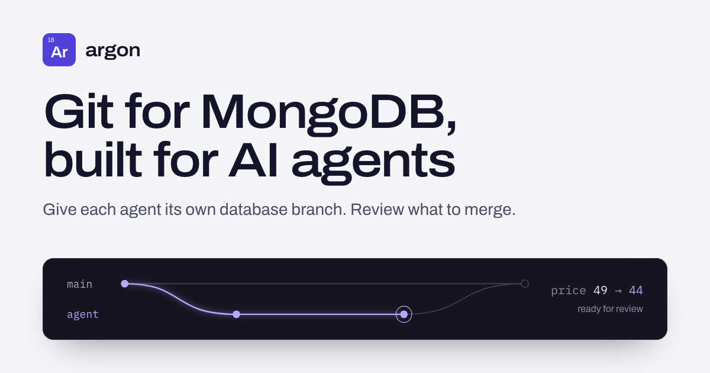

# Argon — MongoDB sandboxes for AI agents

<p align="center">
  <a href="https://argonlabs.tech">
    
  </a>
</p>

[](https://github.com/argon-lab/argon/actions/workflows/ci.yml)
[](https://goreportcard.com/report/github.com/argon-lab/argon)
[](https://opensource.org/licenses/MIT)
[](https://github.com/argon-lab/homebrew-tap)
[](https://www.npmjs.com/package/argonctl)
[](https://pypi.org/project/argon-agents/)
[](https://mcp.market/server/argon-lab-argon)

**Give every agent run its own real MongoDB database, forked from your data.
Review what it changed, merge what you want, discard the rest. Git-style
branching, time travel and merge underneath. Any driver, real mongod.**

Three ideas, thirty seconds:

1. **A sandbox is a real MongoDB database** — forked from a branch or a pinned
   dataset, checked out and given a TTL in one command. pymongo, mongoose,
   mongosh, indexes, aggregation, transactions: all real.
2. **What the agent wrote is a diff** — supported document writes become
   history while capture is healthy, so a run can be reviewed, merged as a data
   pull request, undone or thrown away. Your source data is untouched until you
   merge.
3. **Underneath, it is Git for MongoDB** — a branch is a pointer created with a
   metadata write; checkout separately materializes the data. Diff, merge, undo
   and pins work within the configured retention and capture guarantees.

## Install

For npm, use Node.js 24 LTS with npm 11.16 or newer. The package-scoped
approval allows the installer to download Argon's binary on npm 12.

```bash
brew install argon-lab/tap/argonctl      # macOS or Linux, builds from source
npm install -g argonctl --allow-scripts=argonctl # cross-platform

# MongoDB must run as a replica set (one-node is fine):
docker run -d --name argon-mongo -p 127.0.0.1:27017:27017 mongo:7 --replSet rs0
docker exec argon-mongo mongosh --quiet --eval 'rs.initiate({_id:"rs0",members:[{_id:0,host:"localhost:27017"}]})'
argon doctor
```

Use a current supported MongoDB patch release in production. Source builds use
Go 1.26.11 or newer, as declared in `go.mod`. Use a patched toolchain: on the
Go 1.27 line that means 1.27.4 or newer, which carry the same standard-library fixes.

## The flow

```
your data ──sandbox──▶ mongodb://…  ← the agent, any driver
                           │
          argon diff ──────┤  what the run changed
              ▼            ▼
   merge (a data PR)   or  discard / undo
```

```bash
# 0 · Bring your data in once. Stop source writers and DDL for the import — or: argon projects create myapp
argon import database --uri mongodb://localhost:27017 --database myapp --project myapp --source-quiesced

# 1 · In terminal A, a sandbox: fork + checkout + TTL + capture in one command.
#     Prints its name and a connection string, then keeps capturing until Ctrl-C
argon sandbox create -p myapp --ttl 1h --watch --actor agent:run-1

# In terminal B, point the agent at the printed URI. Then:

# 2 · Review, then adopt the run — a data pull request
argon diff          -p myapp -b <sandbox>
argon merge preview -p myapp -b <sandbox>
argon merge apply <plan-id>

# …or throw the run away
argon sandbox discard -p myapp -b <sandbox>
```

Through the MCP server or `argon console`, capture and expiry are managed for
you: nothing stays in the foreground, and expired sandboxes are swept every
minute. `--watch` needs 2.3.0 or newer; on older versions run
`argon watch -p myapp -b <sandbox> --actor agent:run-1` after creating the sandbox.
Long-lived branches work the same way with `argon branches create` and
`argon checkout`, and `argon restore reset` rewinds a branch to an earlier time.

Prefer clicking? `argon console` serves a local web console (UI + REST API),
supervises capture, reaps expired sandboxes every minute, and opens your browser.
The console's MIT-licensed source is in [web/](web/README.md); see the
[rebuild instructions](CONTRIBUTING.md#console-source-and-reproducible-assets).
For a complete managed workflow, run [the two-agent pinned dataset example](examples/pinned_agents.py).

## For AI agents

```bash
claude mcp add argon -- argon mcp        # 13 tools: sandbox, diff, merge, undo, pins
# Install the published Python SDK and LangGraph adapter.
python3 -m pip install 'argon-agents[langgraph]==0.2.0'
```

Start `argon console --no-browser` in another terminal, then:

```python
from argon_agents import ArgonClient, ArgonCheckpointSaver

argon = ArgonClient("http://127.0.0.1:1818")
argon.get_or_create_project("myapp")
saver = ArgonCheckpointSaver.from_sandbox(argon, "myapp")
# Compile and run your LangGraph graph with checkpointer=saver, then review:
plan = argon.merge_preview("myapp", saver.sandbox.branch)
print(plan)
# After reviewing this exact plan, apply it explicitly:
# argon.merge_apply(plan["id"])
# Or reject the run: saver.discard()

argon.create_pin("myapp", "eval-v1")                        # pin the dataset once
run = argon.sandbox_from_pin("myapp", "eval-v1")            # identical state, every eval run
```

`saver.merge()` is a convenience call that previews and applies immediately;
use the separate calls above when approval is required. Pins protect captured
document state while they exist; keep independent backups.

To keep a person in the loop, withhold tools from the MCP server:
`argon mcp --disable-tools argon_merge_apply` leaves applying a merge plan to
`argon merge apply <plan-id>`, and `argon mcp --read-only` offers only the
tools that inspect state.

The full agent workflow: [docs/AGENTS.md](docs/AGENTS.md).

## What you get

| | Command | In one line |
|---|---|---|
| **Sandboxes** | `argon sandbox create --ttl 1h` | fork + checkout + TTL in one step — disposable agent workspaces |
| **Dataset pins** | `argon pin create` / `pin sandbox` | named captured states protected from GC and resets while the pin exists |
| **Data PRs** | `argon merge preview/apply` | three-way merges as reviewable plans; conflicts never silent |
| **Undo** | `argon undo --actor <a>` | revert a range or actor label; append-only, conflict-aware |
| **Real databases** | `argon checkout` / `argon proxy` | any driver, real mongod; proxy serves stable `mongodb://host/<project>~<branch>` URIs |
| **Write capture** | `argon watch` | exact change-stream images → history, one actor label per branch |
| **Branching** | `argon branches create` | a metadata write — instant, zero copy |
| **Time travel** | `argon time-travel query` | query captured document states at retained LSNs; restore/pin also accept timestamps |
| **Restore** | `argon restore preview/reset/branch` | rewind a released branch or fork retained history |
| **Web console** | `argon console` | local UI + REST API in one command |

Data history covers document inserts, updates, replacements and deletes. Collection
drop/rename produces degraded capture; indexes and collection options are not
versioned. Native writes are asynchronous; control operations drain capture.
Stop writers before release. Existing pins protect their referenced states, while GC can expire audit
and undo history. See [operations](docs/OPERATIONS.md) for recovery and credentials.

Two things to know before handing a sandbox to an agent. A collection the agent
creates is captured exactly while capture is running, or when it is next
synchronized within MongoDB's snapshot history (five minutes by default); the
one exception is a document that is updated and then changed again inside one
transaction on a collection created moments earlier. Before 2.3.1 such a collection needed
`argon collections prepare` first. And a sandbox is a full physical copy with
capture ready, so creating one takes longer as the data grows: the
[benchmarks](https://github.com/argon-lab/benchmarks) measure it as
`sandbox_capture_ready_ms`.

Storage retention uses snapshots + retention-window GC to keep state plus a
window of history, not every write forever. Details and the consistency
model, stated honestly: [ARCHITECTURE.md](docs/ARCHITECTURE.md).

## Documentation

| | |
|---|---|
| [Quick start](docs/QUICK_START.md) | install → first merge, step by step |
| [CLI reference](docs/CLI.md) | every command |
| [Agents](docs/AGENTS.md) | sandboxes, pins, MCP, REST API, argon-agents, proxy |
| [Architecture](docs/ARCHITECTURE.md) | how it works and what it guarantees |
| [Operations](docs/OPERATIONS.md) | deployment, chunk stores (S3/FS), GC, v1→v2 migration |
| [Performance](docs/PERFORMANCE.md) | every number lives in the [reproducible benchmarks](https://github.com/argon-lab/benchmarks) — none here, by policy |

## Community

[Issues](https://github.com/argon-lab/argon/issues) ·
[Discussions](https://github.com/argon-lab/argon/discussions) ·
[Contributing](CONTRIBUTING.md) ·
[argonlabs.tech](https://argonlabs.tech) · [Blog](https://argonlabs.tech/blog)

## Contributors

Thank you to everyone who has made Argon better.

<a href="https://github.com/argon-lab/argon/graphs/contributors">
  
</a>

What each person shipped, and the release it shipped in, is listed at
[argonlabs.tech/about#contributors](https://argonlabs.tech/about#contributors).
Every release also names its new contributors in the
[release notes](https://github.com/argon-lab/argon/releases).

New here? Start with a
[good first issue](https://github.com/argon-lab/argon/issues?q=is%3Aissue+is%3Aopen+label%3A%22good+first+issue%22)
and the [first-contribution guide](CONTRIBUTING.md#your-first-contribution).

---

<div align="center">

**Give your MongoDB a time machine. Branch without fear.** ⭐

</div>
