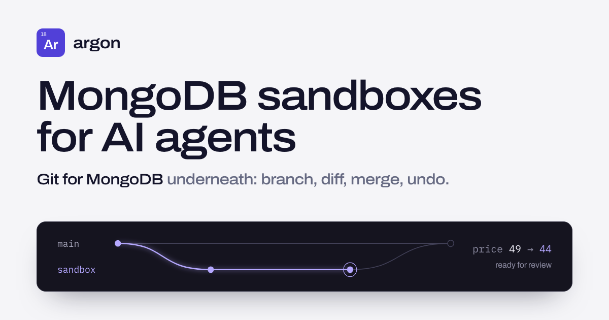

# Argon — 面向 AI 智能体的 MongoDB 沙箱

[English](README.md) | [简体中文](README.zh-CN.md)

<p align="center">
  <a href="https://argonlabs.tech">
    
  </a>
</p>

[](https://github.com/argon-lab/argon/actions/workflows/ci.yml)
[](https://goreportcard.com/report/github.com/argon-lab/argon)
[](https://opensource.org/licenses/MIT)
[](https://github.com/argon-lab/homebrew-tap)
[](https://www.npmjs.com/package/argonctl)
[](https://pypi.org/project/argon-agents/)
[](https://mcp.market/server/argon-lab-argon)

**让每次智能体运行都拥有一个真实的 MongoDB 数据库，由你的数据 fork 而来。审查它改了什么，合并你想要的，丢弃其余部分。底层是 MongoDB 版的 Git：branch、diff、merge、时间旅行和 undo。任何驱动都可以用，货真价实的 mongod。**

三个要点，三十秒读完：

1. **沙箱就是一个真实的 MongoDB 数据库** —— 由某个分支或 pin 住的数据集 fork 而来，一条命令即可完成 checkout 并设置 TTL。pymongo、mongoose、mongosh、索引、聚合、事务：一切都是真实的。
2. **智能体写入的内容就是一份 diff** —— 在采集（capture）状态良好的期间，受支持的文档写入都会被记录为历史，所以一次运行可以被审查、作为数据 PR 合并、被撤销或直接丢弃。在你合并之前，源数据不会被触碰。
3. **底层是 MongoDB 版的 Git** —— 分支（branch）只是一次元数据写入所创建的指针；checkout 则会单独物化数据。diff、merge、undo 和 pin 都在所配置的保留窗口与采集保障内工作。相关命令在下方[与 Git 并列对照](#git-for-mongodb)。

## 安装

使用 npm 时，请使用 Node.js 24 LTS 和 npm 11.16 或更高版本。npm 12 的包作用域批准（approval）允许安装程序下载 Argon 的二进制文件。

```bash
brew install argon-lab/tap/argonctl      # macOS or Linux, builds from source
npm install -g argonctl --allow-scripts=argonctl # cross-platform

# MongoDB must run as a replica set (one-node is fine):
docker run -d --name argon-mongo -p 127.0.0.1:27017:27017 mongo:7 --replSet rs0
docker exec argon-mongo mongosh --quiet --eval 'rs.initiate({_id:"rs0",members:[{_id:0,host:"localhost:27017"}]})'
argon doctor
```

生产环境请使用当前受支持的 MongoDB 补丁发布版本。从源码构建需要 Go 1.26.11 或更高版本，以 `go.mod` 中声明的为准。请使用已修补的工具链：在 Go 1.27 系列中就是 1.27.4 或更高版本，这些版本包含相同的标准库修复。

## 使用流程

```
your data ──sandbox──▶ mongodb://…  ← the agent, any driver
                           │
          argon diff ──────┤  what the run changed
              ▼            ▼
   merge (a data PR)   or  discard / undo
```

```bash
# 0 · Bring your data in once, from a database nobody is writing to — or: argon projects create myapp
#     (a database that is in use: see "A database that is in use" below)
argon import database --uri mongodb://localhost:27017 --database myapp --project myapp --source-quiesced

# 1 · In terminal A, a sandbox: fork + checkout + TTL + capture in one command.
#     Prints its name and a connection string, then keeps capturing until Ctrl-C
argon sandbox create -p myapp --ttl 1h --watch --actor agent:run-1

# In terminal B, point the agent at the printed URI. Then:

# 2 · Review, then adopt the run — a data pull request
argon diff          -p myapp -b <sandbox>
argon merge preview -p myapp -b <sandbox>
argon merge apply <plan-id>

# …or throw the run away
argon sandbox discard -p myapp -b <sandbox>
```

在启用了访问控制的 MongoDB 部署上，为 `argon sandbox create` 加上 `--credential`，即可获得一个只能读写该沙箱的 URI。命令打印出 URI 时请保存好。该凭证在你丢弃沙箱、或清扫程序在过期后将其回收之前一直有效。详见[暴露面与凭证](docs/OPERATIONS.md#exposure-and-credentials)。

通过 MCP 服务器或 `argon console`，采集与过期都会被自动管理：没有任何进程需要停留在前台，过期的沙箱每分钟清扫一次。`--watch` 需要 2.3.0 或更高版本；在旧版本上，请在创建沙箱之后运行 `argon watch -p myapp -b <sandbox> --actor agent:run-1`。长期分支的用法一样：使用 `argon branches create` 和 `argon checkout`；`argon restore reset` 可以把分支回退到更早的时间点。

### 使用中的数据库

在线导入（online import）和 `argon source` 命令自 2.6.0 起已默认可用。你可以在写入仍在继续时导入副本集数据库，然后让项目的 `main` 跟踪源的变更。回写（write-back）也已默认可用。请在 CLI JSON 中审查计划（plan），并在把它应用到源时传入其摘要（digest）。实验性选项 `--auto-resync` 和 `--enable-source-images` 默认关闭，且各自都需要设置 `ARGON_EXPERIMENTAL_SOURCE=1`。部署测试覆盖了带认证的 TLS 连接、三成员源上的主节点选举、搭配 7.0 引擎的 MongoDB 6.0 和 8.0 源，以及搭配 7.0 源的 8.0 引擎。Atlas 本身与分片（sharded）源尚未经过测试。关于源角色与部署限制，请参阅[运维指南](docs/OPERATIONS.md#following-a-source-database)。

```bash
export ARGON_SOURCE_URI="mongodb://…"     # read per command, never stored
argon import preview --database myapp --online
argon import database --database myapp --project myapp --online
argon source follow -p myapp              # main tracks the source; leave it running

argon sandbox create -p myapp --ttl 1h --watch --actor agent:run-1
argon merge preview -p myapp -b <sandbox> --output json
argon merge apply <plan-id> --write-back --approve <approval_digest>
```

导入会在同一个集群时间点复制普通集合，并打印出该时间点。为导入命令加上 `--dry-run`，可以检查源及其变更流（change stream），并查看预计的复制量，而不写入任何数据。跟踪（follow）会忽略对视图的变更。新的合并计划会保存有序 BSON。CLI 的 JSON 预览和列表会显示 apply 的写入顺序，用规范扩展 JSON（canonical Extended JSON）保留 BSON 类型，用美元符号前缀字段来标识字面文档，并在 JSON 丢失 BSON 区分的地方显示精确字节。对于指向被跟踪数据库的待处理计划，请检查该输出，并把它的 `approval_digest` 传给 `--approve`。要检查已保存的计划，请运行 `argon merge list -p myapp --output json`。批准之前，请运行 `argon merge check <plan-id>`，以报告与源之间以及计划内部的唯一索引冲突。由旧版本保存的计划需要重新执行预览。回写要求：每次替换或删除都要有已验证并已保存的前镜像（before-image），每次插入或替换都要有已验证的后镜像（after-image）。空计划只在元数据中完成。对于非空计划，Argon 会检查采集健康状态，以多数派确认（majority acknowledgment）认领该计划，然后在同一个源事务中逐字节检查现有文档、并确认插入键不存在。提交之前，它会再次读取每个受影响的键，以验证所存储的精确 BSON 或确认已被删除。一旦不匹配，整个批次回滚，计划退回待处理（pending）状态。回写前，必须在可编辑分支上修改 `_id` 之外的顶层零 BSON 时间戳。当最近的认领尚未结算时，detach 会拒绝执行，并报告更早的未结算计划以供检查。回写和 `--enable-source-images` 要求使用允许运行 `replSetGetConfig` 的用户来导入，例如拥有 `clusterMonitor` 角色的用户。可以用 `argon source status` 查看适用哪种身份检查。MCP 服务器和 REST API 不提供回写。Argon 永远不会删除、重命名或改写源数据库。详见[运维指南](docs/OPERATIONS.md#following-a-source-database)。

回写会在认领计划之前，拒绝上限集合（capped collection）和逐字节完全相同的替换。普通合并在解码存储的镜像时，也会检查已弃用的 BSON 二进制子类型 2 的内部长度。

较旧的删除可能指向空的子类型 2 `_id`，也可能指向四个零字节。依赖它的读取会报告该键。如果 GC 删除了相关的 WAL，而子类型 2 的 ID 证据仍然保留，需要旧快照的读取会报告未知的 LSN 范围。对于被跟踪的分支，请停止 follower 并运行 `argon source resync -p myapp --force`。对于普通分支，请从更早的可读 LSN fork 出新分支（`argon restore branch`），或回退其头部（`argon restore reset`）。使用 `argon import database` 时，副本会导入到一个新项目中，现有分支保留其历史。详见[升级与恢复细节](docs/OPERATIONS.md#upgrading-older-snapshots)。

如果计划一直停留在 `writing_back` 状态，请检查源上受影响的文档，让跟踪追平进度，然后为该沙箱重新运行 `argon merge preview`。

运行 `argon source status -p myapp`，查看 `main` 是否已在其保存的源集群时间点上通过验证。在精确检查点（checkpoint）干净停止时退出码为零；当存活的 follower 从该检查点重新打开流时，`restarting` 状态同样以零退出。即使状态显示 `stopped`，只要存在未关闭的追平区间、存储的采集错误或已过期的属主，退出码就为非零。表格和 JSON 输出会给出原因与下一步操作。`argon status` 和 `argon doctor` 报告相同的健康状态。回写预检要求状态为 `exact`。详见[源状态表](docs/OPERATIONS.md#what-argon-source-status-reports-and-what-to-do)。

每个项目同时只能运行一个 follower 或 resync。租约（lease）丢失后请重启跟踪，并让替换者验证其检查点。`argon source follow --auto-resync` 会完成未完成的 resync，或修复源流的缺口。该选项在启动时检查 `ARGON_EXPERIMENTAL_SOURCE=1`。

运维人员可以直接在 MongoDB 上启用 `changeStreamPreAndPostImages`，也可以在在线导入或跟踪时使用 `--enable-source-images`。启用后，`source follow --enable-source-images` 会在修改每个集合之前检查租约。变更之后出错会列出受影响的集合。

喜欢点界面？`argon console` 提供本地 Web 控制台（UI + REST API），监督采集，每分钟回收过期的沙箱，并自动打开浏览器。控制台基于 MIT 许可的源码见 [web/](web/README.md)；另见[重新构建说明](CONTRIBUTING.md#console-source-and-reproducible-assets)。要体验完整的托管工作流，请运行[双智能体固定数据集示例](examples/pinned_agents.py)。

## 面向 AI 智能体

```bash
claude mcp add argon -- argon mcp        # 13 tools: sandbox, diff, merge, undo, pins
# Install the published Python SDK and LangGraph adapter.
python3 -m pip install 'argon-agents[langgraph]==0.2.0'
```

在另一个终端启动 `argon console --no-browser`，然后：

```python
from argon_agents import ArgonClient, ArgonCheckpointSaver

argon = ArgonClient("http://127.0.0.1:1818")
argon.get_or_create_project("myapp")
saver = ArgonCheckpointSaver.from_sandbox(argon, "myapp")
# Compile and run your LangGraph graph with checkpointer=saver, then review:
plan = argon.merge_preview("myapp", saver.sandbox.branch)
print(plan)
# After reviewing this exact plan, apply it explicitly:
# argon.merge_apply(plan["id"])
# Or reject the run: saver.discard()

argon.create_pin("myapp", "eval-v1")                        # pin the dataset once
run = argon.sandbox_from_pin("myapp", "eval-v1")            # identical state, every eval run
```

`saver.merge()` 是一个便捷调用，会立即预览并应用；需要人工批准时，请使用上面拆开的两个调用。pin 在其存在期间会保护已采集的文档状态；请另外保留独立的备份。

为了让人来把关，可以从 MCP 服务器中隐藏工具：`argon mcp --disable-tools argon_merge_apply` 会把应用合并计划留给 `argon merge apply <plan-id>` 执行；而 `argon mcp --read-only` 只提供查看状态的工具。

在代码沙箱中运行、由智能体编写的代码，可以通过一个专为本次运行创建的 MongoDB 用户写入 Argon 沙箱：[examples/boxd-sandbox](examples/boxd-sandbox/) 使用一台隔离的 [boxd](https://boxd.sh/) 机器实现了这一点；boxd 的文档中也有[该集成的专页](https://docs.boxd.sh/use-cases/oss-integrations/argon)。

完整的智能体工作流见：[docs/AGENTS.md](docs/AGENTS.md)。

<a id="git-for-mongodb"></a>

## MongoDB 版的 Git

在沙箱之下，Argon 对 MongoDB 文档所做的事，正如 Git 对文件所做的事。并列对照：

| In Git | In Argon | 对你的数据做什么 |
|---|---|---|
| `git branch` | `argon branches create` | 在共享历史中添加一个指针；不复制任何文档 |
| `git worktree add` | `argon sandbox create` | 为新分支提供它自己的工作副本：一个真实的 MongoDB 数据库，带有 TTL |
| `git diff` | `argon diff` | 列出某个分支将新增、修改或删除的文档 |
| `git merge` | `argon merge preview`，然后 `argon merge apply` | 先把变更保存为可审查的计划，再精确应用该计划 |
| `git checkout <commit>` | `argon time-travel query` | 读取保留历史中某个较早位置的数据 |
| `git revert` | `argon undo` | 用一条新变更撤销之前的写入；历史不会被改写 |
| `git tag` | `argon pin create` | 为一个固定状态命名，并在 pin 存在期间保护其历史 |

与 Git 的不同之处：没有 commit 这一步，因为运行中的采集进程会记录每一次文档变更。合并从一个分支进入其父分支，并比较整个文档。checkout 一个分支会复制它的数据，因此所需时间和存储取决于数据集大小。文档会被版本化；索引和集合选项不会。超出保留窗口的历史可以被回收，除非有 pin 加以保护。

## 你能得到什么

| | 命令 | 一句话说明 |
|---|---|---|
| **沙箱** | `argon sandbox create --ttl 1h [--credential]` | 带 TTL 的 fork，可选一个仅限于该沙箱的 MongoDB 用户 |
| **数据集 pin** | `argon pin create` / `pin sandbox` | 具名的已采集状态，pin 存在期间受 GC 和重置保护 |
| **数据 PR** | `argon merge preview/apply` | 三路合并，生成可审查的计划；冲突绝不被静默处理 |
| **撤销** | `argon undo --actor <a>` | 回滚一个区间或 actor 标签；只追加、可感知冲突 |
| **真实数据库** | `argon checkout` / `argon proxy` | 任何驱动，真实的 mongod；proxy 提供稳定的 `mongodb://host/<project>~<branch>` URI |
| **写入采集** | `argon watch` | 精确的变更流镜像 → 历史；每个分支一个 actor 标签 |
| **分支** | `argon branches create` | 一次元数据写入 —— 即时完成，零复制 |
| **时间旅行** | `argon time-travel query` | 在保留的 LSN 上查询历史文档状态；restore/pin 也接受时间戳 |
| **恢复** | `argon restore preview/reset/branch` | 回退一个已发布的分支，或 fork 保留的历史 |
| **Web 控制台** | `argon console` | 一条命令启动本地 UI + REST API |

数据历史覆盖文档的插入、更新、替换和删除。集合的删除/重命名会导致采集降级；索引和集合选项不被版本化。原生写入是异步的；控制操作会排空采集。发布前请停止写入。现有的 pin 会保护它们所引用的状态，而 GC 可能让审计和撤销历史过期。恢复与凭证信息见[运维文档](docs/OPERATIONS.md)。

在把沙箱交给智能体之前，有两件事需要了解。智能体新建的集合，在采集运行期间会被精确采集；否则会在下一次同步时被采集 —— 同步发生在 MongoDB 的快照历史窗口内（默认五分钟）；唯一的例外是：某个文档在刚创建不久的集合上，于同一事务内被更新后又再次修改。在 2.3.1 之前，这类集合需要先运行 `argon collections prepare`。另外，沙箱是采集就绪的完整物理副本，因此数据越多，创建所需时间越长：[基准测试](https://github.com/argon-lab/benchmarks) 用 `sandbox_capture_ready_ms` 来衡量这一点。

存储保留采用“快照 + 保留窗口 GC”的方式：保留当前状态加上一段历史窗口，而不是永久保存每一次写入。详情以及坦诚给出的一致性模型，见 [ARCHITECTURE.md](docs/ARCHITECTURE.md)。

## 文档

| | |
|---|---|
| [快速上手](docs/QUICK_START.md) | 安装 → 首次合并，逐步讲解 |
| [CLI 参考](docs/CLI.md) | 所有命令 |
| [智能体](docs/AGENTS.md) | 沙箱、pin、MCP、REST API、argon-agents、proxy |
| [架构](docs/ARCHITECTURE.md) | 工作原理与所作保证 |
| [运维](docs/OPERATIONS.md) | 部署、块存储（S3/FS）、GC、v1→v2 迁移 |
| [性能](docs/PERFORMANCE.md) | 所有数据都来自[可复现的基准测试](https://github.com/argon-lab/benchmarks) —— 按政策，这里不列任何数字 |

## 社区

[Jake Wang](https://jakewang.io/about/) 负责维护 Argon。

[问题反馈](https://github.com/argon-lab/argon/issues) ·
[讨论区](https://github.com/argon-lab/argon/discussions) ·
[参与贡献](CONTRIBUTING.md) ·
[argonlabs.tech](https://argonlabs.tech) · [博客](https://argonlabs.tech/blog)

## 贡献者

感谢每一位让 Argon 变得更好的人。

<a href="https://argonlabs.tech/about#contributors">
  
</a>

每位贡献者做了什么、在哪个版本发布，都列在 [argonlabs.tech/about#contributors](https://argonlabs.tech/about#contributors)。每个版本的[发布说明](https://github.com/argon-lab/argon/releases)也会点名新贡献者。

刚到这里？从一个 [good first issue](https://github.com/argon-lab/argon/issues?q=is%3Aissue+is%3Aopen+label%3A%22good+first+issue%22) 开始，并阅读[首次贡献指南](CONTRIBUTING.md#your-first-contribution)。

---

<div align="center">

**给你的 MongoDB 装上时间机器。放心分支，无所顾虑。** ⭐

</div>
